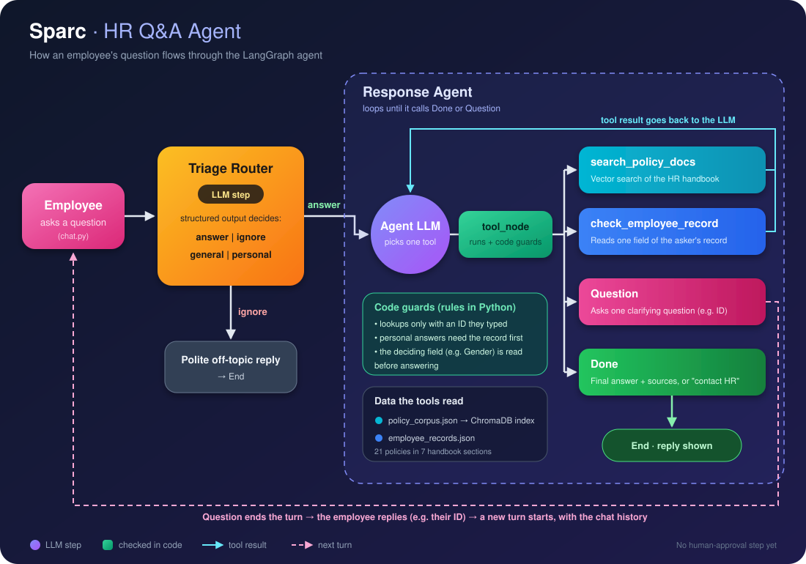

# Sparc · HR Q&A Agent

**Sparc** is an HR assistant for Experion Technologies employees. It answers questions about company HR policies and about the employee's own HR details, cites where every answer came from, asks for missing details instead of guessing, and sends anything that needs a human decision to HR.

Built with **LangGraph**, following the design from LangChain Academy's *Ambient Agents with LangGraph* course.


---

## How it works



1. **Triage router.** An LLM call with structured output decides whether the message is an HR question (`answer`) or off-topic (`ignore`), and whether it is **general** (same for every employee) or **personal** (depends on who is asking).
2. **Response agent.** An LLM loop that picks **one tool at a time** until it calls `Done` or `Question`.
3. **Code guards.** Every tool call goes through `tool_node`, where plain Python rules check it before it runs (see below).
4. **Follow-ups.** `Question` ends the turn. The employee's reply (for example their employee ID) starts a new turn with the conversation history, so the agent picks up where it left off.

### Example

```
Sparc: Hi there! Sparc here. Got an HR question? I'm happy to help.

You:   How much can I claim for a certification course?
Sparc: You can claim up to 30,000 rupees per year for job-relevant courses and
       certifications. Manager approval is needed before enrolling.
       (Source: HR Policy Handbook, Section 4.3)

You:   Can I work from home 2 days a week?
Sparc: Could you share your employee ID so I can check your eligibility?
You:   366
Sparc: No, you're not eligible for regular work from home, because your
       employment status is Probation.
       (Source: HR Policy Handbook, Section 1.2; Employee Record)
```

---

## Tools

| Tool | What it does |
|---|---|
| `search_policy_docs` | Vector search (ChromaDB + OpenAI embeddings) over the HR policy handbook. Returns the matching policy text with its section, e.g. `HR Policy Handbook, Section 2.2`. |
| `check_employee_record` | Reads **one field** of the asking employee's record (status, type, gender, joining date, manager, leave balances...). |
| `Question` | Asks the employee **one** short clarifying question, such as their employee ID. Ends the turn. |
| `Done` | Sends the final answer with its sources, or tells the employee to contact HR for exceptions. |

## Code guards

Prompts tell the model what to do; these rules in `tool_node` make sure it actually happens:

| Guard | Rule |
|---|---|
| ID check | `check_employee_record` only runs with an employee ID the employee actually typed in the conversation. The model can never look up an ID by itself. |
| Ask for the ID, not the value | The agent can't ask for something the record already holds ("maternity or paternity?", "are you on probation?"). It asks for the ID instead. |
| Deciding field first | If the policy depends on who is asking (e.g. `female` / `male` → **Gender**, `probation` / `permanent` → **Employment Status**, `intern` / `full-time` → **Employment Type**), the agent must read that field before it can answer. |
| Record before answer | A personal question can't be answered until the employee's record has been checked. |
| One answer, not options | Once the record is known, answers like "if you are X... if you are Y..." are sent back to be rewritten for that one employee. |

## Answer style

- Every answer ends with one source line: `(Source: HR Policy Handbook, Section X.Y; Employee Record)`
- Personal answers start with the direct answer ("Yes" / "No" / the number), then a short reason.
- Exceptions (waivers, special cases) are never answered with a plain "Yes": the agent explains it isn't automatic, who approves it, and points to HR.
- If what the employee says about themselves differs from their record, the record wins.

---

## Project structure

```
hr_qa_agent/
├── config.py               # all settings: models, paths, search tuning, bot identity, replies
├── policy_agent.py         # vector store, tools, triage router, response agent, code guards, ask()
├── chat.py                 # terminal chat (greeting, exit words, conversation history)
├── data/
│   ├── policy_corpus.json      # 21 sample HR policies in 7 handbook sections
│   └── employee_records.json   # 20 sample employees with HR fields
├── assets/
│   └── sparc_agent_flow.svg    # the diagram above
└── Documentation/          # build notes
```

The vector index (`chroma_data/`) is not in the repo. It is built automatically on the first run, and rebuilt whenever `policy_corpus.json` changes.

---

## Getting started

**Requirements:** Python 3.12+, [uv](https://docs.astral.sh/uv/), an Anthropic API key (chat model) and an OpenAI API key (embeddings).

```bash
git clone https://github.com/Madhav-A-14/HR_QA_AGENT.git
cd HR_QA_AGENT
uv sync
```

Create a `.env` file in the project folder:

```
ANTHROPIC_API_KEY=your-anthropic-key
OPENAI_API_KEY=your-openai-key
```

Run the chat:

```bash
uv run chat.py
```

The first run prints `Building Policy Index` while it embeds the policies; later runs start straight away. Type `bye`, `exit` or `thank you` to end the chat.

## Configuration

Everything is set in `config.py`:

| Setting | Default | Meaning |
|---|---|---|
| `MODEL_NAME` | `anthropic:claude-haiku-5-5` | Chat model for the router and the agent |
| `EMBEDDING_MODEL` | `text-embedding-3-small` | Embedding model (delete `chroma_data/` if you change it) |
| `TOP_K` | `2` | Max policies returned per search |
| `MAX_DISTANCE` | `0.7` | Drops matches farther than this (cosine distance) |
| `RELATIVE_GAP` | `0.15` | Drops results much weaker than the best match |
| `RECURSION_LIMIT` | `15` | Safety cap on the agent loop |
| `DEBUG_SEARCH` | `True` | Prints each search and its distances to the console |
| `BOT_NAME`, `COMPANY_NAME` | `Sparc`, `Experion Technologies` | Identity used in greetings and prompts |

---

## Limitations

- **Sample data only.** The policies and employees are made-up examples.
- **No identity check.** Anyone can type any employee ID; a sign-in step is needed before real data is used.
- **Short-term memory only.** The conversation is forgotten when `chat.py` stops.
- **No human-in-the-loop yet.** Escalations tell the employee to contact HR; nothing is sent to HR automatically.

## Roadmap

- Employee verification before record lookups
- Human-in-the-loop escalation to HR
- Long-term memory (LangGraph Store)
- Experion Employee MCP server as the employee data source
- A chat interface in place of the terminal
